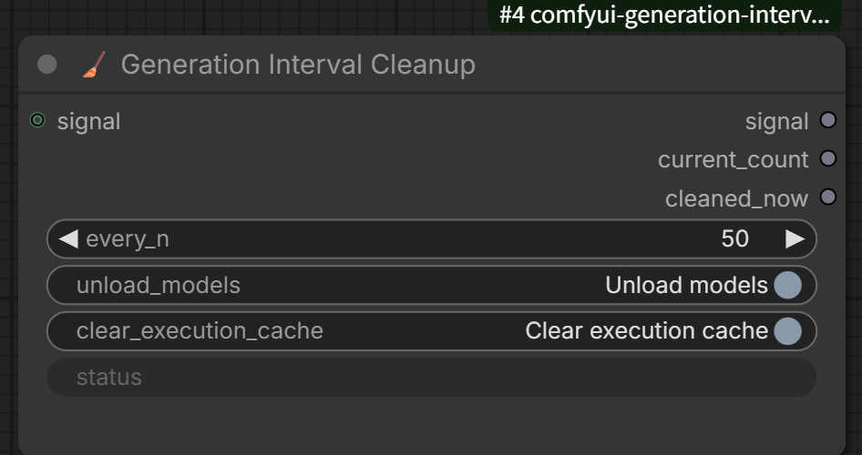

# ComfyUI Generation Interval Cleanup

[English](README_EN.md) | 日本語



**ノード名:** `Generation Interval Cleanup`  
**内部識別子:** `GenerationIntervalCleanup`

ComfyUIで実行したPrompt（Queue）を1回ずつ累計し、指定回数に達した処理の完了後だけ、モデルとメモリキャッシュの解放を要求するカスタムノードです。

`every_n = 50`の場合、50回分をまとめて生成するのではなく、通常どおり実行した50回目、100回目、150回目……の完了後にクリーンアップします。このノードがQueueを追加したり、連続生成を開始したりすることはありません。

## 既存機能との関係

このリポジトリで新規実装しているのは、次の部分です。

- Prompt実行回数の累計
- ワークフローごとのカウンター管理
- 指定回数到達時の判定とカウンターの循環
- 現在回数とクリーンアップ実行状態の表示
- 指定回数に達した場合だけ、ComfyUIへ解放を要求する処理

メモリ解放そのものを独自実装しているわけではありません。指定回数に達すると、ComfyUI本体の`PromptQueue.set_flag()`を使用して、標準の`free_memory`および`unload_models`処理を要求します。ComfyUI本体が現在のPromptを最後まで処理した後、モデルのアンロード、実行キャッシュのリセット、Pythonのガベージコレクション、デバイスキャッシュの解放を行います。

`comfyui_memory_cleanup`の`VRAMCleanup`など、既存のメモリ解放カスタムノードは呼び出しておらず、依存関係もありません。既存カスタムノードのコードを同梱・改変・再配布しているものでもありません。利用しているのはComfyUI本体が提供する解放機構です。

## 動作例

`every_n = 3`の場合：

| Prompt実行 | 表示カウント | クリーンアップ |
| ---: | ---: | :--- |
| 1回目 | 1 / 3 | なし |
| 2回目 | 2 / 3 | なし |
| 3回目 | 3 / 3 | Prompt完了後に実行 |
| 4回目 | 1 / 3 | なし |

カウント単位は画像枚数ではなくPrompt実行数です。1回のPromptで4枚のバッチ画像を生成した場合でも、カウントは1回だけ進みます。

## クリーンアップ内容

初期設定では、指定回数に達したPromptの完了後に以下を要求します。

- ロード済みモデルのアンロード
- ComfyUIの実行キャッシュのリセット
- Pythonの不要オブジェクト回収
- CUDAなど、使用中デバイスのキャッシュ解放

実行中のモデルを途中で強制的に取り外す方式ではありません。ノードがQueueフラグを設定し、ComfyUI本体がPrompt完了後に安全なタイミングで処理します。

## インストール

このフォルダをComfyUIの`custom_nodes`内へ配置します。

```text
ComfyUI/
└─ custom_nodes/
   └─ comfyui-generation-interval-cleanup/
      ├─ __init__.py
      ├─ README.md
      └─ web/
         └─ status.js
```

配置後、ComfyUIを再起動してください。

## 使い方

1. ノード検索から`Generation Interval Cleanup`を追加します。
2. `every_n`へ実行間隔を入力します。
3. 通常どおりPromptをQueueします。

このノードは出力ノードとして動作するため、`signal`を接続しなくても各Promptでカウントされます。

生成が最後まで成功した場合だけカウントしたいときは、`Save Image`へ渡す直前の`IMAGE`など、完了判定に使う出力を`signal`へ接続してください。接続元の処理が失敗してこのノードまで到達しなかったPromptはカウントされません。

## 入力

| 入力 | 初期値 | 説明 |
| :--- | :---: | :--- |
| `every_n` | `50` | クリーンアップを要求するPrompt実行間隔です。バッチ枚数ではありません。 |
| `unload_models` | `true` | 指定回数到達時に、ロード済みモデルのアンロードを要求します。 |
| `clear_execution_cache` | `true` | ComfyUI実行キャッシュと不要なメモリの解放を要求します。 |
| `signal` | 未接続 | 任意型のパススルー入力です。特定処理の完了後だけ数える場合に接続します。 |

## 出力

| 出力 | 説明 |
| :--- | :--- |
| `signal` | 入力された値をそのまま返します。 |
| `current_count` | 今回の実行回数です。指定回数到達時は指定値を返し、次回は1へ戻ります。 |
| `cleaned_now` | 今回クリーンアップを要求した場合だけ`true`になります。 |

## カウンターの保持範囲

カウンターは、可能な場合はワークフローIDとノードIDの組み合わせごとに分離されます。同じワークフロー内に複数配置した場合も、それぞれ独立して数えます。

カウントはComfyUIプロセスのメモリ上に保持されるため、ComfyUIを再起動すると0へ戻ります。ワークフローファイルへのカウント保存や、再起動をまたぐ永続化は行いません。

## 制限事項

- ComfyUIプロセス自体を再起動するノードではありません。
- Pythonや各カスタムノードが独自に保持するすべての状態を初期化できるわけではありません。
- OSやドライバーが確保しているメモリまで、完全にプロセス再起動直後と同じ状態になることは保証できません。
- Queueへ登録されたPromptがこのノードを含まない場合、そのPromptはカウントされません。
- 1回のPrompt内で生成される画像・動画フレーム・バッチの個数はカウントしません。

## 実装概要

指定回数へ到達すると、次のQueueフラグを設定します。

```python
PromptServer.instance.prompt_queue.set_flag("free_memory", True)
PromptServer.instance.prompt_queue.set_flag("unload_models", True)
```

フラグは現在のPrompt処理後にComfyUI本体で消費されます。そのため、このノードは次の生成を自動実行せず、現在の生成回数を増やすためのバッチ処理も行いません。
