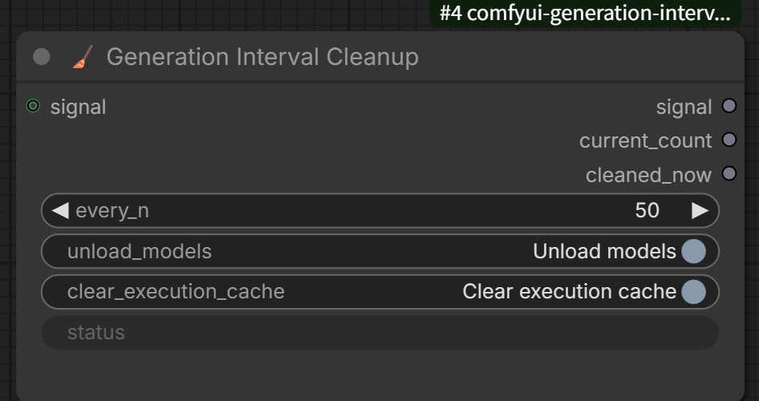

# ComfyUI Generation Interval Cleanup

English | [日本語](README.md)



**Node name:** `Generation Interval Cleanup`  
**Internal identifier:** `GenerationIntervalCleanup`

A custom ComfyUI node that counts prompt executions one at a time and requests model and memory cleanup only after a user-defined interval.

With `every_n = 50`, cleanup is requested after the 50th, 100th, 150th, and subsequent prompt executions. The value does **not** create a 50-image batch, add prompts to the queue, or start continuous generation.

## What this project implements

This project adds the following behavior:

- Counts prompt executions
- Maintains an independent counter for each workflow and node when workflow metadata is available
- Detects when the configured interval has been reached
- Resets the counter after requesting cleanup
- Displays the current count and cleanup status in the node
- Requests cleanup only at the configured interval

The underlying memory cleanup is not reimplemented here. When the interval is reached, the node uses ComfyUI's own `PromptQueue.set_flag()` mechanism to request the standard `free_memory` and `unload_models` operations.

ComfyUI consumes these flags after the current prompt has finished. It then unloads models, resets the execution cache, runs Python garbage collection, and releases the device cache.

This node does **not** call or depend on third-party cleanup nodes such as `VRAMCleanup` from `comfyui_memory_cleanup`. No code from those nodes is bundled, modified, or redistributed. The only cleanup mechanism used by this project is the one provided by ComfyUI itself.

## Example

With `every_n = 3`:

| Prompt execution | Displayed count | Cleanup |
| ---: | ---: | :--- |
| 1 | 1 / 3 | Not requested |
| 2 | 2 / 3 | Not requested |
| 3 | 3 / 3 | Requested after the prompt finishes |
| 4 | 1 / 3 | Not requested |

The counter tracks prompt executions, not the number of generated images. A prompt that generates a batch of four images still increases the counter by one.

## Cleanup operations

With the default settings, the node requests the following operations after the interval is reached:

- Unload loaded models
- Reset ComfyUI's execution cache
- Collect unreachable Python objects
- Release the active device cache, including the CUDA allocator and IPC cache when CUDA is in use

Models are not forcibly removed in the middle of the current prompt. The node sets queue flags, and ComfyUI performs the cleanup after prompt execution has completed.

## Installation

Copy this directory into ComfyUI's `custom_nodes` directory:

```text
ComfyUI/
└─ custom_nodes/
   └─ comfyui-generation-interval-cleanup/
      ├─ __init__.py
      ├─ README.md
      ├─ README_EN.md
      └─ web/
         └─ status.js
```

Restart ComfyUI after installing the node.

## Usage

1. Add `Generation Interval Cleanup` from the node search menu.
2. Set `every_n` to the desired cleanup interval.
3. Queue prompts normally.

The node is registered as an output node, so it can count prompt executions without a connection to `signal`.

To count only executions that successfully reach a specific stage, connect an output from that stage to `signal`. For image workflows, the `IMAGE` output immediately before `Save Image` is a practical choice. If the upstream operation fails and this node is never reached, that execution is not counted.

## Inputs

| Input | Default | Description |
| :--- | :---: | :--- |
| `every_n` | `50` | Number of prompt executions between cleanup requests. This is not a batch-size setting. |
| `unload_models` | `true` | Requests that loaded checkpoints, text encoders, VAEs, and other managed models be unloaded. |
| `clear_execution_cache` | `true` | Requests execution-cache reset, garbage collection, and device-cache cleanup. |
| `signal` | Not connected | Optional pass-through input. Connect it to count only executions that reach a specific stage. |

## Outputs

| Output | Description |
| :--- | :--- |
| `signal` | Returns the input value unchanged. |
| `current_count` | Current execution count. It returns the configured interval on a cleanup run and starts again at 1 on the next run. |
| `cleaned_now` | Returns `true` when cleanup was requested for the current execution. |

## Counter scope and lifetime

When workflow metadata is available, counters are separated by workflow ID and node ID. Multiple copies of the node in one workflow therefore maintain independent counters.

Counter state is stored in the running ComfyUI process. Restarting ComfyUI resets the count to zero. The count is not written to the workflow file and does not persist across process restarts.

## Limitations

- This node does not restart the ComfyUI process.
- It cannot reset every piece of state maintained internally by Python extensions or other custom nodes.
- It cannot guarantee the exact memory state of a fresh process because the operating system, GPU driver, CUDA context, and native libraries may retain allocations.
- A prompt that does not contain this node is not counted.
- Images, video frames, and batch items produced inside one prompt are not counted separately.
- Cleanup can make the next prompt slower because unloaded models must be loaded again.
- Regular cleanup is useful only when retained memory or cache pressure is causing a measurable slowdown. It is not an unconditional performance optimization.

## Implementation overview

When the configured interval is reached, the node sets ComfyUI queue flags equivalent to the following:

```python
PromptServer.instance.prompt_queue.set_flag("free_memory", True)
PromptServer.instance.prompt_queue.set_flag("unload_models", True)
```

ComfyUI consumes the flags after the current prompt has finished. The node does not submit another prompt and does not use the interval value as a generation count or batch size.
